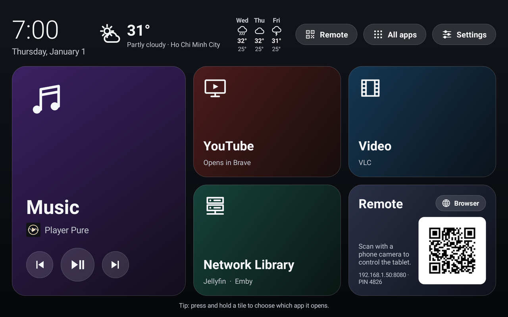
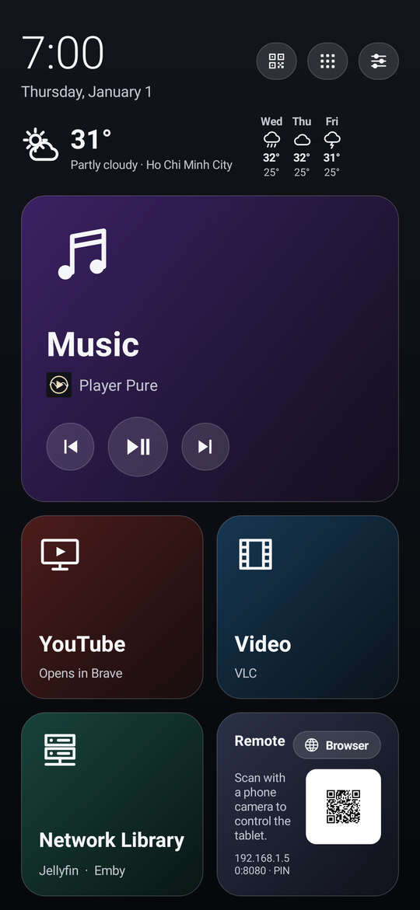
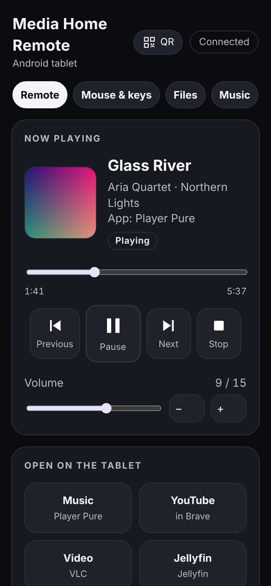
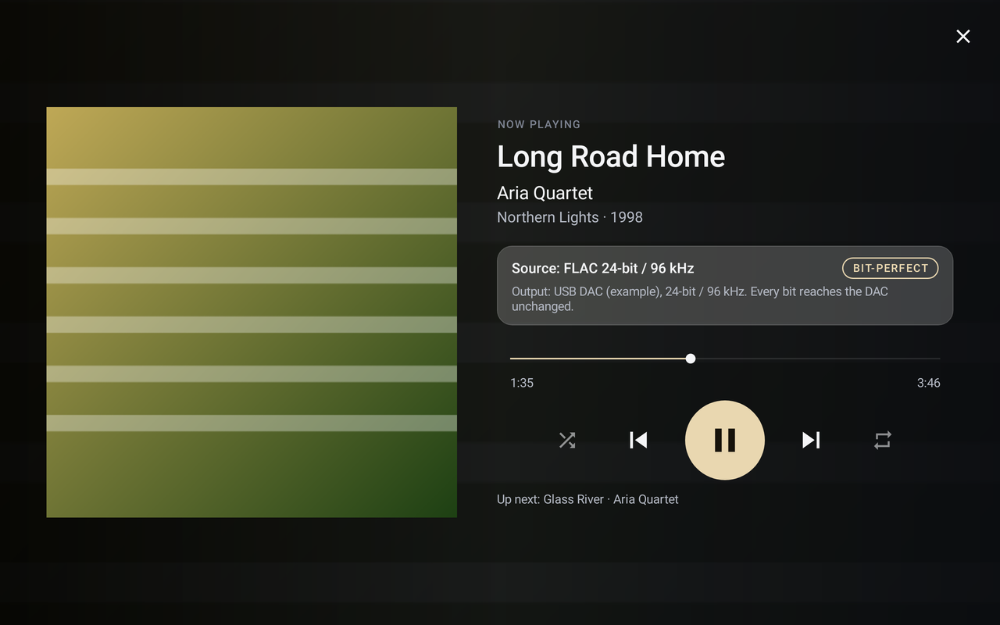
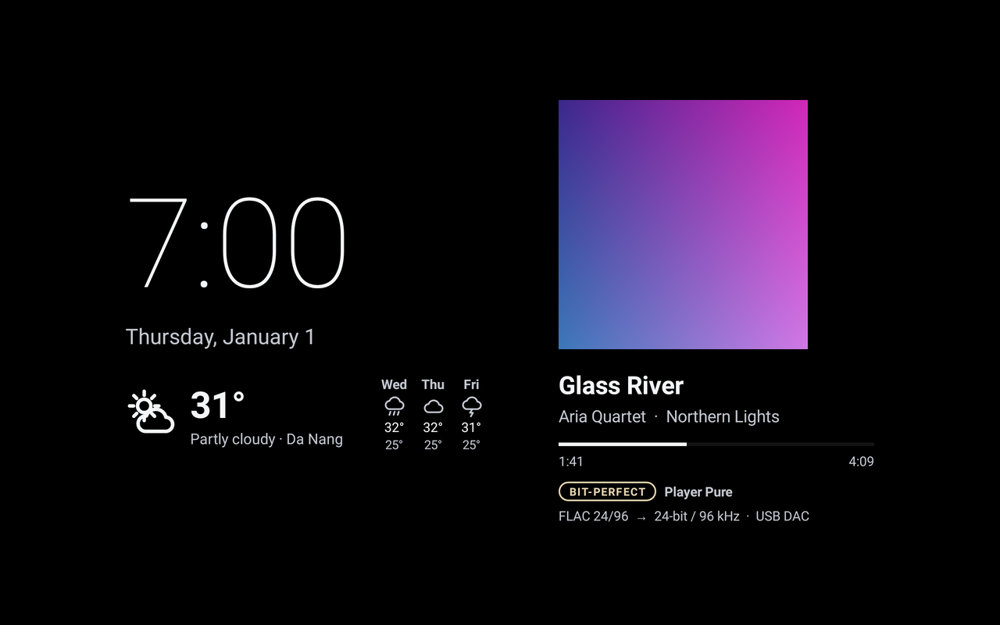

# Media Home Pure

**Turn an Android tablet or phone into a calm media centre: a big-tile home screen, a bit-perfect music player for USB DACs,
a web remote for your phone, and a clock-and-weather screen saver. One free APK, no account, no ads, no tracking.**

[Tiếng Việt](README.vi.md) · [Manual](docs/MANUAL.md) · [Download](https://github.com/PureEye108/media-home-pure/releases/latest) · MIT licence



| Phone | Web remote | Player Pure | Screen saver |
|---|---|---|---|
|  |  |  |  |

## What you get

- **Home screen**: large tiles for Music, YouTube, Video, Network Library (Jellyfin/Emby) and Browser, a clock, and the weather where you are.
  Press and hold a tile to choose which app it opens. Media Home Pure can be your Home app, or just an app you open.
- **Player Pure, built in**: plays music from the device and from USB drives: FLAC, ALAC, WAV, AIFF, DSD (DSF/DFF), CUE sheets, MP3, AAC, Ogg, Opus.
  With a **USB DAC** it uses its own USB Audio driver, so the music reaches the DAC **bit-perfect** (Android's mixer and resampler are skipped),
  up to 768 kHz and native DSD where the DAC supports it. A big **DAC screen** shows the rate, format and volume.
- **Web remote**: open the address (or scan the QR code) on any phone or computer on the same Wi-Fi. Play/pause, volume, open apps,
  browse and play your music library, a touchpad and keyboard, a file manager, and YouTube search. Protected by a PIN.
- **Screen saver**: while charging, a big clock, the weather and the music that is playing, instead of a dark screen.
- **Set up in a few taps**: on first start a checklist explains each permission and opens the right Android page. Everything is optional.
- **11 languages**: English, Tiếng Việt, Español, 中文（简体）, हिन्दी, Français, Deutsch, 日本語, 한국어, Português (Brasil), Русский.
  It follows the device's language, or pick one in Settings.

## Install

1. Download `MediaHomePure-<version>.apk` from [Releases](https://github.com/PureEye108/media-home-pure/releases/latest) on the device.
2. Open it. Android asks to allow installing apps from your browser or file manager: allow it, then **Install**.
3. Open **Media Home Pure**. The **Set up** checklist opens: go through the steps you want (all optional).

Needs **Android 11 or newer**. Works on phones and tablets (designed for a 10-inch tablet; on phones everything is drawn a little smaller).
For USB DACs and drives the device needs USB host (OTG) support, which almost all phones and tablets have.

The full step-by-step guide, including Android 13+'s "restricted settings" and how to check the download, is in the **[Manual](docs/MANUAL.md)**
([Tiếng Việt](docs/MANUAL.vi.md)).

## YouTube

YouTube itself works without anything extra (the YouTube tile opens YouTube in Brave or the YouTube app).
Only the web remote's **YouTube search** ("Play first video", "Search & pick") needs your **own free YouTube Data API key**: it takes about
5 minutes once, see [docs/YOUTUBE-KEY.md](docs/YOUTUBE-KEY.md). No key is built into the app.
This app does not block or skip ads; for ad-free YouTube use YouTube Premium.

## Privacy

No account, no analytics, no ads. The app connects only to Open-Meteo for the weather (with your location rounded to about 1 km),
to YouTube's official API if you add your own key, and to the devices on your own Wi-Fi that use the web remote.
Details: [docs/PRIVACY.md](docs/PRIVACY.md).

## Status

1.0.0 is the first public release. It comes from the author's own Samsung Galaxy Tab S7 FE media setup, and has been checked with
automated tests (115 unit tests, native decoder tests bit-exact against FFmpeg, web remote page tests) and screen renders on tablet and phone sizes.
It has not yet been tried on many different devices or DACs: please [report](https://github.com/PureEye108/media-home-pure/issues) what works and what doesn't.

## Build it yourself

```
git clone https://github.com/PureEye108/media-home-pure.git
cd media-home-pure
./gradlew assembleDebug
```

Needs JDK 17, Android SDK 34, NDK 27.0.12077973 and CMake 3.22.1. See [docs/BUILDING.md](docs/BUILDING.md).

## Licence and credits

MIT licence, see [LICENSE](LICENSE). Third-party code: dr_flac/dr_wav (public domain or MIT-0), Apple ALAC decoder (Apache 2.0),
ZXing (Apache 2.0), Material icons (Apache 2.0); weather data by Open-Meteo.com. Details: [THIRD-PARTY-NOTICES.md](THIRD-PARTY-NOTICES.md).

Made by [PureEye108](https://github.com/PureEye108), with help from Claude (Anthropic) for the code, translations and documentation.
