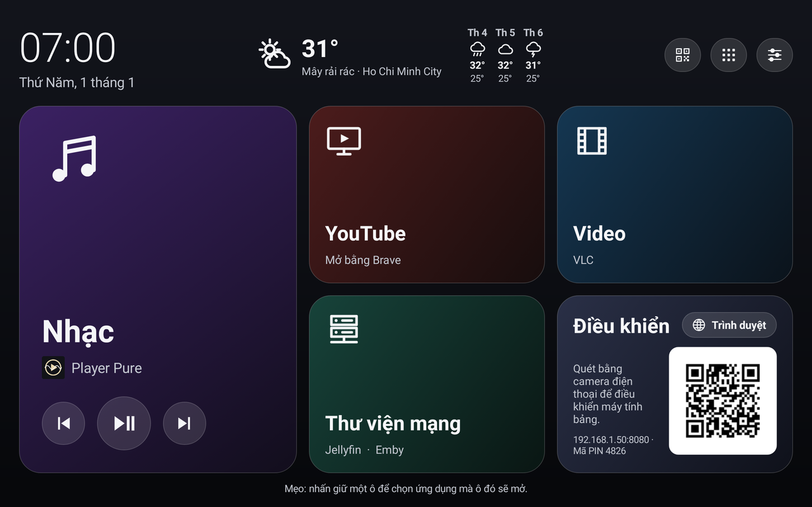
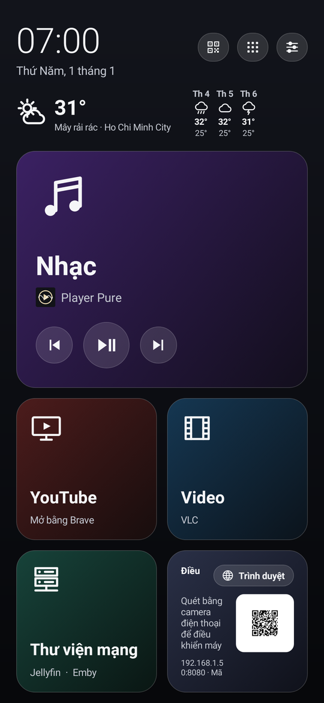
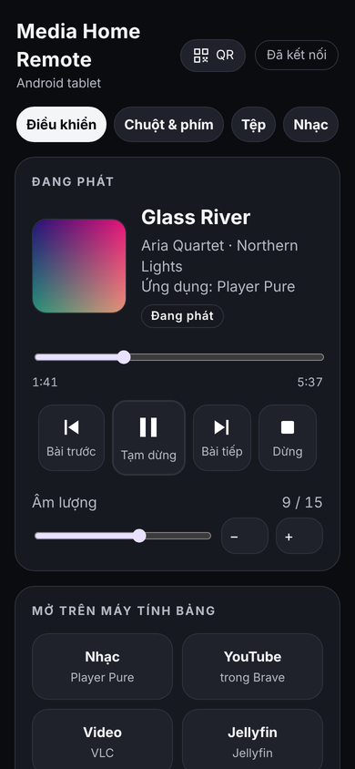
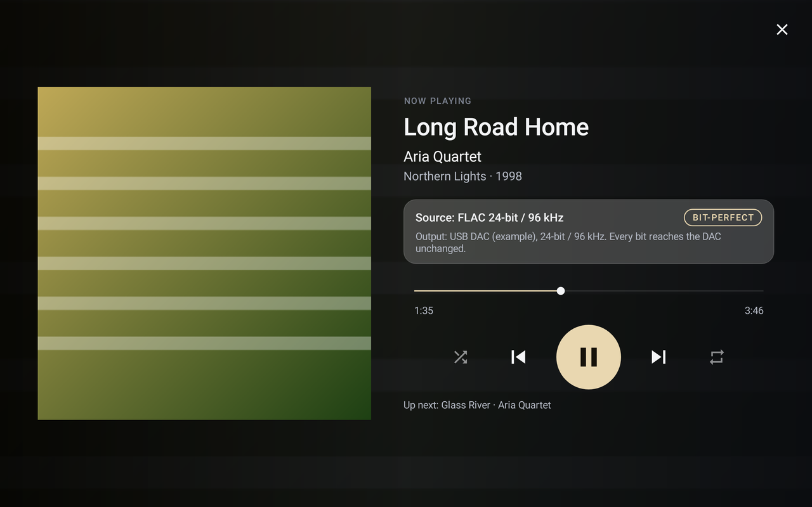
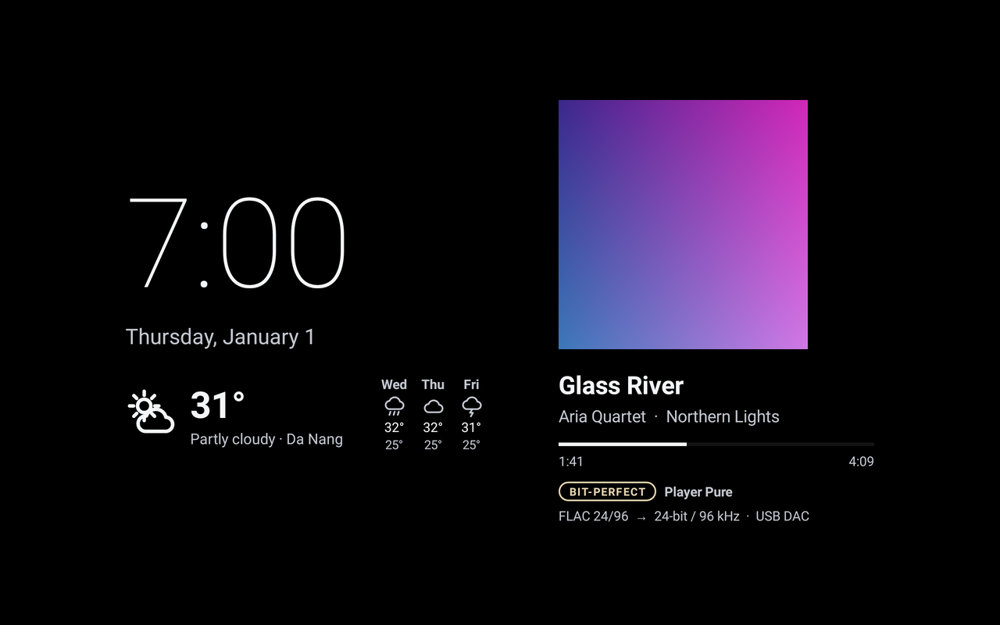

# Media Home Pure

**Biến máy tính bảng hoặc điện thoại Android thành một trung tâm đa phương tiện gọn gàng, dễ chịu: màn hình chính với các ô lớn, trình phát nhạc bit-perfect cho DAC USB,
điều khiển qua web từ điện thoại, và trình bảo vệ màn hình có đồng hồ và thời tiết. Chỉ một tệp APK miễn phí, không cần tài khoản, không quảng cáo, không theo dõi.**

[English](README.md) · [Hướng dẫn sử dụng](docs/MANUAL.vi.md) · [Tải về](https://github.com/PureEye108/media-home-pure/releases/latest) · Giấy phép MIT



| Điện thoại | Điều khiển qua web | Player Pure | Trình bảo vệ màn hình |
|---|---|---|---|
|  |  |  |  |

## Có gì trong ứng dụng

- **Màn hình chính**: các ô lớn cho Nhạc, YouTube, Video, Thư viện mạng (Jellyfin/Emby) và Trình duyệt, kèm đồng hồ và thời tiết tại nơi bạn ở.
  Nhấn giữ một ô để chọn ứng dụng mà ô đó sẽ mở. Media Home Pure có thể làm ứng dụng màn hình chính của bạn, hoặc chỉ là một ứng dụng bạn mở khi muốn.
- **Player Pure, có sẵn trong ứng dụng**: phát nhạc trên thiết bị và trên ổ USB: FLAC, ALAC, WAV, AIFF, DSD (DSF/DFF), CUE sheet, MP3, AAC, Ogg, Opus.
  Với **DAC USB**, Player Pure dùng driver USB Audio riêng, nên nhạc đến DAC **bit-perfect** (bỏ qua bộ trộn âm và bộ lấy mẫu lại của Android),
  lên đến 768 kHz và DSD gốc nếu DAC hỗ trợ. **Màn hình DAC** cỡ lớn hiển thị tần số lấy mẫu, định dạng và âm lượng.
- **Điều khiển qua web**: mở địa chỉ (hoặc quét mã QR) trên bất kỳ điện thoại hay máy tính nào dùng cùng mạng Wi-Fi. Phát/tạm dừng, âm lượng, mở ứng dụng,
  duyệt và phát thư viện nhạc, bàn di chuột và bàn phím, trình quản lý tệp, và tìm kiếm YouTube. Được bảo vệ bằng mã PIN.
- **Trình bảo vệ màn hình**: khi đang sạc, máy hiển thị đồng hồ lớn, thời tiết và bài nhạc đang phát, thay vì một màn hình tối.
- **Thiết lập chỉ với vài lần nhấn**: lần mở đầu tiên, một danh sách các bước sẽ giải thích từng quyền và mở đúng trang của Android. Mọi bước đều không bắt buộc.
- **11 ngôn ngữ**: English, Tiếng Việt, Español, 中文（简体）, हिन्दी, Français, Deutsch, 日本語, 한국어, Português (Brasil), Русский.
  Ứng dụng dùng ngôn ngữ của thiết bị, hoặc bạn có thể chọn một ngôn ngữ trong Cài đặt.

## Cài đặt

1. Trên thiết bị, tải `MediaHomePure-<version>.apk` từ [Releases](https://github.com/PureEye108/media-home-pure/releases/latest).
2. Mở tệp. Android hỏi có cho phép trình duyệt hoặc trình quản lý tệp cài ứng dụng không: hãy cho phép, rồi nhấn **Cài đặt**.
3. Mở **Media Home Pure**. Danh sách **Thiết lập** sẽ mở ra: làm các bước bạn muốn (tất cả đều không bắt buộc).

Cần **Android 11 trở lên**. Chạy được trên điện thoại và máy tính bảng (thiết kế cho máy tính bảng 10 inch; trên điện thoại mọi thứ hiển thị nhỏ hơn một chút).
Để dùng DAC USB và ổ USB, thiết bị cần hỗ trợ USB host (OTG); hầu hết điện thoại và máy tính bảng đều có.

Hướng dẫn đầy đủ từng bước, gồm cả "chế độ cài đặt bị hạn chế" của Android 13 trở lên và cách kiểm tra tệp tải về, có trong **[Hướng dẫn sử dụng](docs/MANUAL.vi.md)**
([English](docs/MANUAL.md)).

## YouTube

Bản thân YouTube hoạt động mà không cần gì thêm (ô YouTube mở YouTube bằng Brave hoặc ứng dụng YouTube).
Chỉ có **tìm kiếm YouTube** của điều khiển qua web ("Phát video đầu tiên", "Tìm & chọn video") mới cần **khóa YouTube Data API miễn phí của riêng bạn**: chỉ mất khoảng
5 phút, làm một lần, xem [docs/YOUTUBE-KEY.vi.md](docs/YOUTUBE-KEY.vi.md). Ứng dụng không có sẵn khóa nào.
Ứng dụng này không chặn hay bỏ qua quảng cáo; để xem YouTube không quảng cáo, hãy dùng YouTube Premium.

## Quyền riêng tư

Không tài khoản, không thu thập số liệu, không quảng cáo. Ứng dụng chỉ kết nối đến Open-Meteo để lấy thời tiết (vị trí của bạn được làm tròn đến khoảng 1 km),
đến API chính thức của YouTube nếu bạn thêm khóa của riêng mình, và đến các thiết bị trong mạng Wi-Fi của bạn đang dùng điều khiển qua web.
Chi tiết: [docs/PRIVACY.md](docs/PRIVACY.md).

## Tình trạng

1.0.0 là bản phát hành công khai đầu tiên. Ứng dụng ra đời từ hệ thống giải trí trên chiếc Samsung Galaxy Tab S7 FE của chính tác giả, và đã được kiểm tra bằng
kiểm thử tự động (115 kiểm thử đơn vị, kiểm thử bộ giải mã native cho kết quả khớp từng bit với FFmpeg, kiểm thử trang điều khiển qua web) và ảnh kết xuất màn hình ở kích thước máy tính bảng và điện thoại.
Ứng dụng chưa được thử trên nhiều thiết bị hay DAC khác nhau: hãy [báo lại](https://github.com/PureEye108/media-home-pure/issues) điều gì chạy được và điều gì chưa.

## Tự biên dịch ứng dụng

```
git clone https://github.com/PureEye108/media-home-pure.git
cd media-home-pure
./gradlew assembleDebug
```

Cần JDK 17, Android SDK 34, NDK 27.0.12077973 và CMake 3.22.1. Xem [docs/BUILDING.md](docs/BUILDING.md).

## Giấy phép và ghi công

Giấy phép MIT, xem [LICENSE](LICENSE). Mã nguồn của bên thứ ba: dr_flac/dr_wav (phạm vi công cộng hoặc MIT-0), bộ giải mã ALAC của Apple (Apache 2.0),
ZXing (Apache 2.0), Material icons (Apache 2.0); dữ liệu thời tiết từ Open-Meteo.com. Chi tiết: [THIRD-PARTY-NOTICES.md](THIRD-PARTY-NOTICES.md).

Do [PureEye108](https://github.com/PureEye108) thực hiện, với sự hỗ trợ của Claude (Anthropic) cho mã nguồn, bản dịch và tài liệu.
