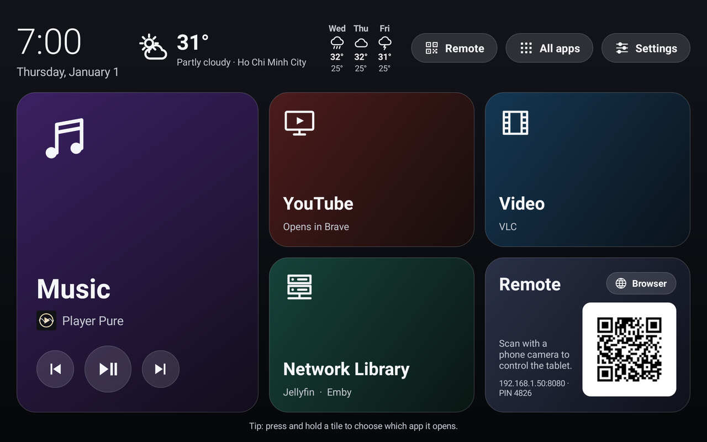
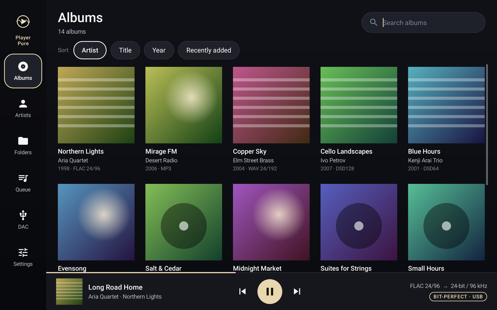
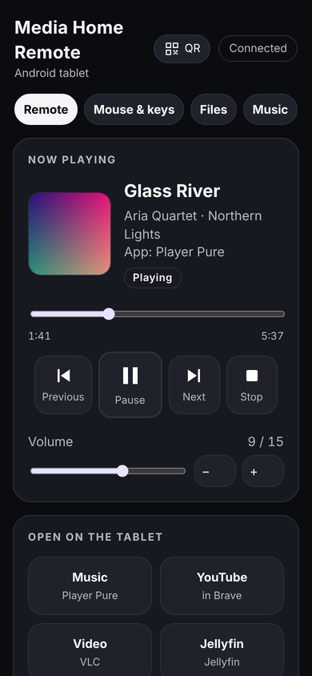
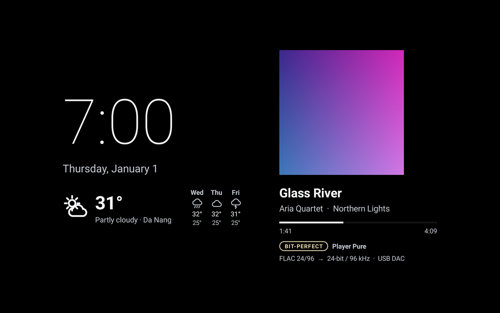

# Media Home Pure: manual

[Tiếng Việt](MANUAL.vi.md) · Version 1.0.0

Media Home Pure turns an Android tablet or phone into a media centre: a big-tile home screen, the bit-perfect music player
**Player Pure**, a **web remote** for your phone or computer, and a clock-and-weather **screen saver**. It is one app (one APK).

**Contents**

1. [What you need](#1-what-you-need)
2. [Install](#2-install)
3. [Set up (first start)](#3-set-up-first-start)
4. [Home screen](#4-home-screen)
5. [Music with Player Pure](#5-music-with-player-pure)
6. [USB DAC: bit-perfect playback](#6-usb-dac-bit-perfect-playback)
7. [Web remote](#7-web-remote)
8. [YouTube](#8-youtube)
9. [Screen saver](#9-screen-saver)
10. [Weather](#10-weather)
11. [Language](#11-language)
12. [Update, stop using, uninstall](#12-update-stop-using-uninstall)
13. [Problems and answers](#13-problems-and-answers)

---

## 1. What you need

- An Android phone or tablet with **Android 11 or newer**. It is designed for a 10-inch tablet; on a phone everything is drawn a little smaller.
- Wi-Fi, for the weather and the web remote.
- Optional: a **USB DAC** (digital-to-analogue converter) or USB drive. Connect it with a USB-C cable or adapter (USB OTG);
  a powered USB-C hub lets you charge at the same time.
- Optional: the apps the tiles open, from Google Play: **Brave** (browser, also opens YouTube), **VLC** (video), **Jellyfin** or **Emby** (media server).
  The Music tile needs nothing extra: Player Pure is built in.

## 2. Install

1. On the phone or tablet, open the [latest release](https://github.com/PureEye108/media-home-pure/releases/latest)
   and download **MediaHomePure-1.0.0.apk**.
2. Open the downloaded file (from the browser's downloads or the Files app).
3. Android says the browser (or Files) isn't allowed to install apps: tap **Settings**, switch on **Allow from this source**, go back.
4. Tap **Install**. If Google Play Protect asks to scan the app, let it; it is an app from a developer it doesn't know yet.
5. Tap **Open**.

**Check the download (optional).** The release page lists the file's SHA-256. On a computer: `certutil -hashfile MediaHomePure-1.0.0.apk SHA256`
(Windows) or `sha256sum MediaHomePure-1.0.0.apk` (macOS/Linux). The release certificate's SHA-256 is
`11:66:3F:D6:A8:C4:FC:57:5C:E3:BD:AC:38:2D:EA:EA:A9:99:7A:3D:57:B2:18:AC:4C:FA:EA:12:82:F6:67:24`
(`apksigner verify --print-certs MediaHomePure-1.0.0.apk` shows it).

**Google's developer verification.** From 30 September 2026 in Brazil, Indonesia, Singapore and Thailand, and worldwide from 2027,
certified Android devices install apps only from registered developers. If Android refuses to install this app, see the release notes for its
registration status; until then Android's own "advanced flow" (Developer options › allow apps from unverified developers, with a one-time wait)
or installing with `adb install` from a computer still work.

## 3. Set up (first start)

The first time Media Home Pure opens, the **Set up** checklist appears. You can open it again any time: **Settings › Set up**.
Each step shows **Done** or **Not yet - tap to set up**. Tap a step, allow it on the Android page that opens, then press **Back**.
Every step is optional; skip what you don't need.

| Step | What it is for | On the Android page |
|---|---|---|
| **Language** | The app's language (default: the device's) | Pick one |
| **Use as the home screen** | Media Home Pure opens when you press Home | Choose **Media Home Pure** and **Set as default** |
| **Notifications** (Android 13+) | The player and the web remote can keep running in the background | **Allow** |
| **Music and files** | Player Pure finds your music; the remote's Files tab works | Switch on **Allow access to manage all files** |
| **See what is playing** | Home screen, screen saver and remote show and control music from any app | Switch on **Media Home Pure** (Notification access) |
| **Weather where you are** | Local weather (approximate location only) | **While using the app** or **Only this time** |
| **Web remote** | Switch it on here; the PIN is shown below it | (in the app) |
| **Display over other apps** | The remote can open apps while another app is on screen | Switch on |
| **Mouse and keyboard from the phone** | The remote's touchpad and keyboard | Accessibility › **Media Home remote mouse & keyboard** › On |
| **YouTube search** (optional) | The remote's YouTube search | Paste your own key, see [YOUTUBE-KEY.md](YOUTUBE-KEY.md) |
| **Screen saver** | Clock, weather and music while charging | Choose **Media Home clock**, start **While charging** |
| **Screen saver timer** | Lets Settings › Screen saver › Start after change the screen timeout | Switch on **Allow modifying system settings** |

**"Restricted setting" (Android 13 and newer).** For apps installed from a file, Android greys out **Notification access** and
**Accessibility** and says it is a restricted setting. To allow them:

1. Try once to switch it on (so Android shows the message), then go back.
2. In the checklist tap **App info** (under Help), or open Android **Settings › Apps › Media Home Pure**.
3. Tap **⋮** (top right) › **Allow restricted settings**, confirm with your PIN or fingerprint.
4. Back in the checklist, tap the step again: the switch now works.

The names of Android's pages differ a little between brands (Samsung, Xiaomi, Pixel...). If a button doesn't open the right page,
look for the same name in Android's own Settings.

## 4. Home screen

- **Top left**: clock and date. **Middle**: the weather now and for the next days. **Top right**: **Remote** (QR code to open the web remote),
  **All apps**, **Settings**. On a narrow screen these become icons.
- **Tiles**:
  - **Music** opens Player Pure, with play/pause and skip buttons for whatever is playing;
  - **YouTube** opens YouTube in Brave, or the YouTube app;
  - **Video** opens VLC (or Kodi);
  - **Network Library** opens Jellyfin or Emby (asks which, if you have both);
  - **Browser** opens Brave.
- A tile whose app isn't installed says so; tap it to get the app from Google Play.
- **Press and hold a tile** to choose any installed app for it (Settings › Choose the app for each tile does the same).
- While the web remote is on and no phone is connected, the Browser tile shows the remote's **QR code**. It turns back into the Browser tile
  as soon as a phone connects (switch this off in Settings › Web remote › QR code on the home screen).
- **Settings › Media Home**: keep the screen on while the home screen shows, full screen (hide the status and navigation bars).

## 5. Music with Player Pure

Open it with the **Music** tile (or its own **Player Pure** icon). The first time, allow **All files access** (Set up › Music and files).

- **Where it looks**: the device's storage and USB drives. It scans a `Music` folder when there is one (best: `Music/Artist/Album/`), otherwise the whole drive.
  Tap **Scan now** after adding music.
- **Formats**: FLAC, ALAC and AAC (.m4a), WAV, AIFF, DSD (.dsf, .dff), MP3, Ogg Vorbis, Opus, and **CUE sheets** (one file per album, split into tracks).
- **Pages** (left bar): Albums, Artists, Folders, Queue, DAC, Settings. Tap an album, then a track to play it, or **Add to queue**.
  Playback is **gapless**.
- **Now playing**: tap the bar at the bottom. It shows the source format and the output, for example `FLAC 24/96 → 24-bit / 96 kHz`, and **BIT-PERFECT**
  when nothing changes the sound on the way.
- Player Pure is laid out for landscape; it turns sideways on a phone.

## 6. USB DAC: bit-perfect playback

Android normally mixes all sound and resamples it (often to 48 kHz) before it reaches a USB DAC. Player Pure talks to the DAC itself
(its own USB Audio Class 1/2 driver), so every bit of the file reaches the DAC unchanged.

1. **Turn the volume down** on the DAC or amplifier first.
2. Connect the DAC. Android asks *Open Player Pure to handle ...?*: tick **Always** and tap **OK**.
3. Play something. Now playing shows the DAC as output and **BIT-PERFECT**. The DAC's own display should follow each track's rate (44.1, 96 kHz...).
4. **Volume**: set it on the DAC or amplifier. If the DAC offers volume over USB, Player Pure's volume and the remote control the DAC directly.
   **Digital volume** (Settings) lets Player Pure lower the level itself for DACs without volume control, but then PCM is no longer bit-perfect.
5. **DSD**: **Convert to PCM** works with every DAC. **Native DSD** sends the DSD bitstream unchanged if the DAC offers a native DSD setting over USB
   (try the DSD64 test tone on the DAC page; if you hear noise, switch on *Swap byte order*). **DoP** only if the DAC's manual says it supports DoP over USB.
6. **DAC page**: a big display for the DAC (rate, format, volume, mute), useful when the DAC's own screen is small, far away or broken.
   It also has test tones and **Save DAC report** (a text file in Download/PlayerPure, useful for bug reports).

Only one app can use the DAC at a time. Sound from other apps (YouTube, video) still plays through Android's normal path.

## 7. Web remote

1. Switch it on: **Set up › Web remote** (or **Settings › Web remote**).
2. On your phone (same Wi-Fi), **scan the QR code** with the camera: it opens the remote and signs in.
   Or type the address shown, for example `http://192.168.1.50:8080`, and the **PIN**.
3. The PIN is made up at random on each device (4 digits). Change it in **Settings › Web remote › Web remote PIN** (4 to 8 digits).

Tabs:

- **Remote**: what is playing (cover, title, position), play/pause/next/previous, volume, buttons that open apps on the tablet, Home screen, Wake screen,
  and a Brave box to open a link, search, or play a video.
- **Mouse & keys**: a touchpad (one finger moves, tap clicks, two fingers scroll) and a keyboard that types into the selected text field on the tablet.
  Needs Set up › Mouse and keyboard.
- **Files**: browse the tablet and USB drives, upload from the phone, download, play, rename, delete (to a trash folder first). Needs All files access.
- **Music**: Player Pure's library, queue and the DAC panel (volume and mute when the DAC allows it).

**Safety**: the remote answers only devices on your local network, every request needs the PIN, and after 10 wrong PINs that address is blocked for
10 minutes. Anyone on your Wi-Fi who knows the PIN (or scans the QR code) can control the tablet, so keep the PIN to people you trust.
Switch the remote off when you don't need it.

## 8. YouTube

- The **YouTube tile** opens youtube.com in Brave, or the YouTube app (press and hold the tile to choose).
- From the web remote, **Go in Brave** and **Search YouTube** work without anything extra.
- **Play first video** and **Search & pick a video** use YouTube's official search API and need **your own free API key**
  (about 5 minutes, once): [YOUTUBE-KEY.md](YOUTUBE-KEY.md). Paste it in Set up › YouTube search, Settings › Web remote › YouTube key,
  or in the web remote when it asks for the key. The key stays on the tablet.
- This app does not block or skip ads. For YouTube without ads, use YouTube Premium.

## 9. Screen saver

While the tablet is **charging** and nobody touches it for the screen timeout, it shows a big clock, the weather, and the music that is playing
(cover, title, progress; with Player Pure also the signal path and BIT-PERFECT). Touch the screen to go back. On battery the screen turns off as usual
(that is Android's rule for screen savers).

1. **Set up › Screen saver**: on Android's page choose **Media Home clock**, and set when to start: **While charging**.
2. **Settings › Screen saver**: **Preview**, **Start after** (1 to 30 minutes; this is Android's screen timeout, so allow *Modify system settings* first),
   show or hide music and weather.
3. If it never starts: turn off **Stay awake while charging** in Developer options, and check that the device is charging.

The picture moves a few pixels every minute and the background is black, to protect the screen.

## 10. Weather

- By default the weather is for **where the device is**, using **approximate** location only. The coordinates are rounded to about 1 km before
  they are sent to Open-Meteo; the place name comes from Android.
- Without location (not allowed, Location off, or no fix yet), it uses the city you chose, or the city of the device's time zone.
- **Settings › Weather**: switch the weather off, **Use a fixed city instead** (search and pick), or **Use the current location** again.
- Indoors a tablet without GPS may need Wi-Fi-based location (Android Settings › Location › Location services).

## 11. Language

English, Tiếng Việt, Español, 中文（简体）, हिन्दी, Français, Deutsch, 日本語, 한국어, Português (Brasil) and Русский.
By default the app follows the device's language. Change it at the top of **Settings › Language**. The web remote follows the same language.
Player Pure's own screens are in English. The translations were made with AI help; corrections are welcome on GitHub.

## 12. Update, stop using, uninstall

- **Update**: download the newer APK from Releases and install it over the old one. Your settings stay.
  (Updates install only if they are signed with the same key, so only official releases update each other.)
- **Stop using it as the home screen**: **Settings › Leave Media Home › Switch back to the standard home screen**, and choose your usual home app.
- **Uninstall**: first switch back to your usual home screen, then Android Settings › Apps › Media Home Pure › Uninstall.
  Turn the screen saver back to another one in Android's screen saver settings if you like.

## 13. Problems and answers

| Problem | What to do |
|---|---|
| "App not installed" | An older or differently signed copy is installed: uninstall it first. Or not enough space. |
| Switch is greyed out ("restricted setting") | See [Set up](#3-set-up-first-start): App info › ⋮ › Allow restricted settings. |
| The phone can't open the remote | Same Wi-Fi as the tablet? Remote switched on? Some routers keep guest Wi-Fi devices apart (client isolation). Use the address shown in Settings. |
| "Wrong PIN", then blocked | Wait 10 minutes, or check the PIN in Settings › Web remote. |
| No music found | Allow All files access, then **Scan now**. Music in a `Music` folder is found first. |
| DAC not used / no BIT-PERFECT | Reconnect the DAC and tick **Always** for Player Pure. Close other music apps. Check Player Pure › DAC. |
| Noise with native DSD | DAC page › *Swap byte order*, or use Convert to PCM. |
| Screen saver never starts | It needs charging. Turn off *Stay awake while charging*. Choose Media Home clock in Android's screen saver settings. |
| Weather shows a city, not my place | Allow approximate location, switch Location on; indoors turn on Wi-Fi-based location. |
| YouTube search says the key is rejected | Check the key and its restrictions ([YOUTUBE-KEY.md](YOUTUBE-KEY.md)); the daily free quota is about 100 searches. |
| The remote stops after a while | Allow Notifications, and exclude Media Home Pure from battery optimisation (Android Settings › Apps › Media Home Pure › Battery › Unrestricted). |

More help or a bug? Open an issue: <https://github.com/PureEye108/media-home-pure/issues>
