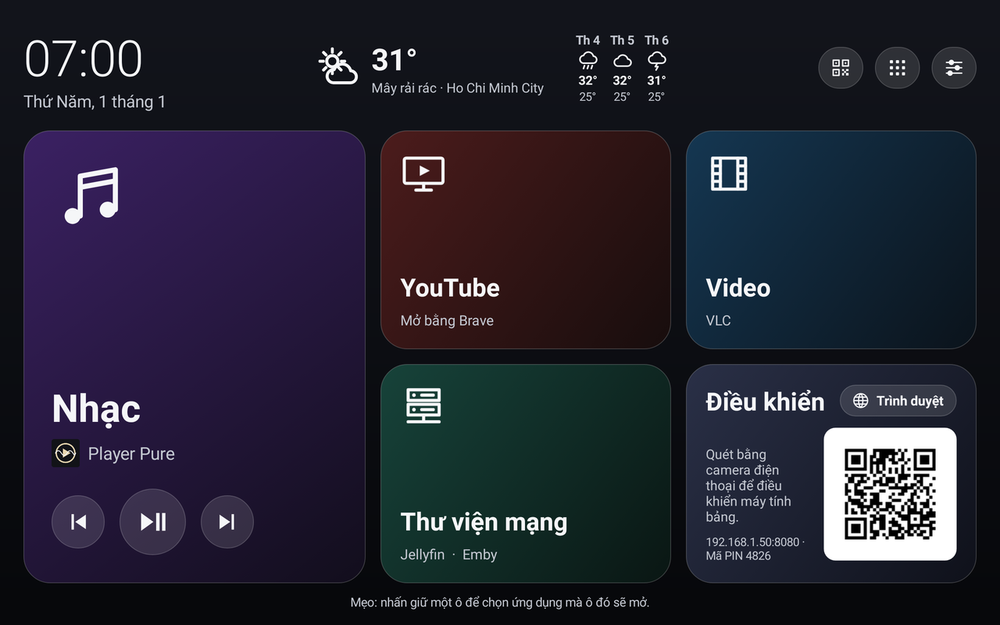
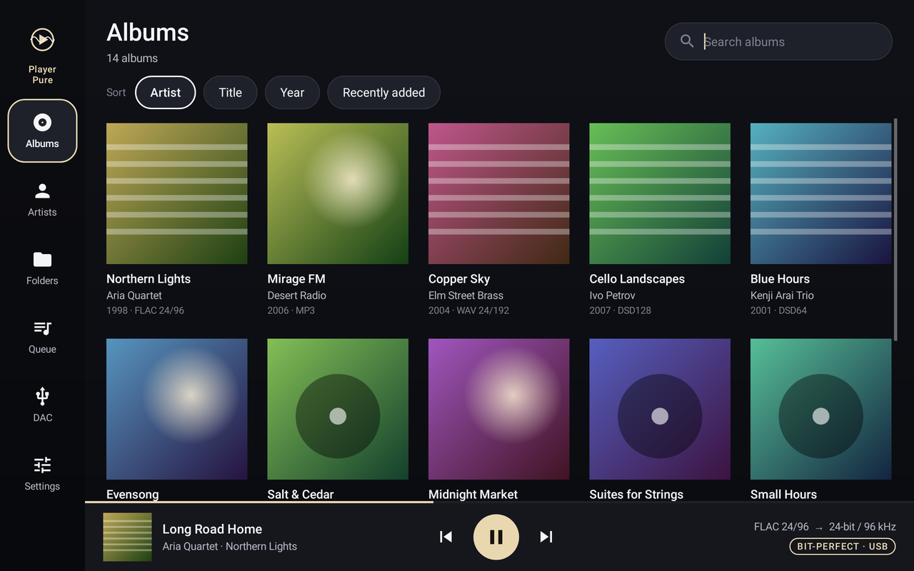
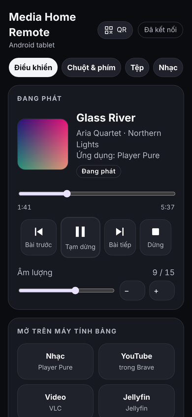
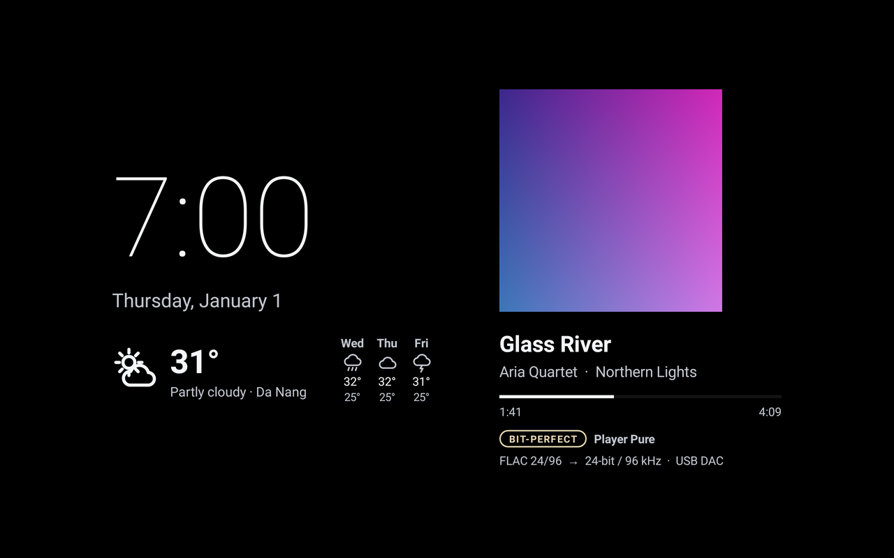

# Media Home Pure: hướng dẫn sử dụng

[English](MANUAL.md) · Phiên bản 1.0.0

Media Home Pure biến máy tính bảng hoặc điện thoại Android thành một trung tâm đa phương tiện: màn hình chính với các ô lớn, trình phát nhạc bit-perfect
**Player Pure**, **điều khiển qua web** dùng trên điện thoại hoặc máy tính, và **trình bảo vệ màn hình** có đồng hồ và thời tiết. Tất cả nằm trong một ứng dụng (một tệp APK).

**Mục lục**

1. [Bạn cần gì](#1-bạn-cần-gì)
2. [Cài đặt ứng dụng](#2-cài-đặt-ứng-dụng)
3. [Thiết lập (lần mở đầu tiên)](#3-thiết-lập-lần-mở-đầu-tiên)
4. [Màn hình chính](#4-màn-hình-chính)
5. [Nghe nhạc với Player Pure](#5-nghe-nhạc-với-player-pure)
6. [DAC USB: phát bit-perfect](#6-dac-usb-phát-bit-perfect)
7. [Điều khiển qua web](#7-điều-khiển-qua-web)
8. [YouTube](#8-youtube)
9. [Trình bảo vệ màn hình](#9-trình-bảo-vệ-màn-hình)
10. [Thời tiết](#10-thời-tiết)
11. [Ngôn ngữ](#11-ngôn-ngữ)
12. [Cập nhật, ngừng dùng, gỡ cài đặt](#12-cập-nhật-ngừng-dùng-gỡ-cài-đặt)
13. [Sự cố và cách xử lý](#13-sự-cố-và-cách-xử-lý)

---

## 1. Bạn cần gì

- Một điện thoại hoặc máy tính bảng chạy **Android 11 trở lên**. Ứng dụng được thiết kế cho máy tính bảng 10 inch; trên điện thoại mọi thứ hiển thị nhỏ hơn một chút.
- Wi-Fi, để xem thời tiết và dùng điều khiển qua web.
- Không bắt buộc: một **DAC USB** (bộ chuyển đổi số sang tương tự) hoặc ổ USB. Kết nối bằng cáp hoặc đầu chuyển USB-C (USB OTG);
  một hub USB-C có cấp nguồn giúp bạn vừa dùng vừa sạc.
- Không bắt buộc: các ứng dụng mà các ô sẽ mở, tải từ Google Play: **Brave** (trình duyệt, cũng dùng để mở YouTube), **VLC** (video), **Jellyfin** hoặc **Emby** (máy chủ đa phương tiện).
  Ô Nhạc không cần gì thêm: Player Pure đã có sẵn.

## 2. Cài đặt ứng dụng

1. Trên điện thoại hoặc máy tính bảng, mở [bản phát hành mới nhất](https://github.com/PureEye108/media-home-pure/releases/latest)
   và tải **MediaHomePure-1.0.0.apk**.
2. Mở tệp vừa tải (trong mục tải xuống của trình duyệt hoặc trong ứng dụng Files).
3. Android báo trình duyệt (hoặc Files) chưa được phép cài ứng dụng: nhấn **Cài đặt**, bật **Cho phép từ nguồn này**, rồi quay lại.
4. Nhấn **Cài đặt**. Nếu Google Play Protect hỏi có quét ứng dụng không, hãy đồng ý; đây là ứng dụng của một nhà phát triển mà Play Protect chưa biết.
5. Nhấn **Mở**.

**Kiểm tra tệp tải về (không bắt buộc).** Trang phát hành có ghi mã SHA-256 của tệp. Trên máy tính: `certutil -hashfile MediaHomePure-1.0.0.apk SHA256`
(Windows) hoặc `sha256sum MediaHomePure-1.0.0.apk` (macOS/Linux). SHA-256 của chứng chỉ phát hành là
`11:66:3F:D6:A8:C4:FC:57:5C:E3:BD:AC:38:2D:EA:EA:A9:99:7A:3D:57:B2:18:AC:4C:FA:EA:12:82:F6:67:24`
(lệnh `apksigner verify --print-certs MediaHomePure-1.0.0.apk` sẽ hiển thị giá trị này).

**Xác minh nhà phát triển của Google.** Từ ngày 30 tháng 9 năm 2026 tại Brazil, Indonesia, Singapore và Thái Lan, và trên toàn thế giới từ năm 2027,
các thiết bị Android được chứng nhận chỉ cài ứng dụng của nhà phát triển đã đăng ký. Nếu Android từ chối cài ứng dụng này, hãy xem ghi chú phát hành để biết tình trạng
đăng ký của ứng dụng; trong lúc chờ, "quy trình nâng cao" (advanced flow) của chính Android (Tùy chọn cho nhà phát triển › cho phép ứng dụng của nhà phát triển chưa xác minh, phải chờ một lần)
hoặc cài bằng lệnh `adb install` từ máy tính vẫn dùng được.

## 3. Thiết lập (lần mở đầu tiên)

Lần đầu tiên bạn mở Media Home Pure, danh sách **Thiết lập** sẽ xuất hiện. Bạn có thể mở lại danh sách này bất cứ lúc nào: **Cài đặt › Thiết lập**.
Mỗi bước hiển thị **Đã xong** hoặc **Chưa xong - nhấn để thiết lập**. Nhấn vào một bước, cho phép trên trang Android vừa mở ra, rồi nhấn **Quay lại**.
Mọi bước đều không bắt buộc; hãy bỏ qua những gì bạn không cần.

| Bước | Dùng để làm gì | Trên trang Android |
|---|---|---|
| **Ngôn ngữ** | Ngôn ngữ của ứng dụng (mặc định: ngôn ngữ của thiết bị) | Chọn một ngôn ngữ |
| **Dùng làm màn hình chính** | Media Home Pure mở ra khi bạn nhấn nút Màn hình chính | Chọn **Media Home Pure** và **Đặt làm mặc định** |
| **Thông báo** (Android 13+) | Trình phát nhạc và điều khiển qua web có thể tiếp tục chạy trong nền | **Cho phép** |
| **Nhạc và tệp** | Player Pure tìm thấy nhạc của bạn; thẻ Tệp của điều khiển từ xa hoạt động | Bật **Cho phép truy cập để quản lý tất cả các tệp** (Allow access to manage all files) |
| **Xem nội dung đang phát** | Màn hình chính, trình bảo vệ màn hình và điều khiển từ xa hiển thị và điều khiển nhạc từ bất kỳ ứng dụng nào | Bật **Media Home Pure** (Quyền truy cập thông báo) |
| **Thời tiết tại nơi bạn ở** | Thời tiết tại chỗ (chỉ dùng vị trí gần đúng) | **Trong khi dùng ứng dụng** hoặc **Chỉ lần này** |
| **Điều khiển qua web** | Bật tính năng tại đây; mã PIN hiển thị ngay bên dưới | (trong ứng dụng) |
| **Hiển thị trên các ứng dụng khác** | Điều khiển từ xa có thể mở ứng dụng khi đang có ứng dụng khác trên màn hình | Bật |
| **Chuột và bàn phím từ điện thoại** | Bàn di chuột và bàn phím của điều khiển từ xa | Hỗ trợ tiếp cận (Accessibility) › **Chuột & bàn phím từ xa Media Home** › Bật |
| **Tìm kiếm YouTube** (không bắt buộc) | Tìm kiếm YouTube trên điều khiển từ xa | Dán khóa của riêng bạn, xem [YOUTUBE-KEY.vi.md](YOUTUBE-KEY.vi.md) |
| **Trình bảo vệ màn hình** | Đồng hồ, thời tiết và nhạc khi đang sạc | Chọn **Đồng hồ Media Home**, bắt đầu **Trong khi sạc** |
| **Hẹn giờ trình bảo vệ màn hình** | Cho phép Cài đặt › Trình bảo vệ màn hình › Bắt đầu sau thay đổi thời gian chờ màn hình | Bật **Cho phép sửa đổi cài đặt hệ thống** |

**"Chế độ cài đặt bị hạn chế" (Android 13 trở lên).** Với ứng dụng được cài từ tệp, Android làm mờ **Quyền truy cập thông báo** và
**Hỗ trợ tiếp cận**, và báo đây là chế độ cài đặt bị hạn chế. Để cho phép:

1. Thử bật một lần (để Android hiện thông báo), rồi quay lại.
2. Trong danh sách thiết lập, nhấn **Thông tin ứng dụng** (trong mục Trợ giúp), hoặc mở **Cài đặt › Ứng dụng › Media Home Pure** của Android.
3. Nhấn **⋮** (góc trên bên phải) › **Cho phép chế độ cài đặt bị hạn chế**, rồi xác nhận bằng mã PIN hoặc vân tay.
4. Quay lại danh sách thiết lập, nhấn lại vào bước đó: lúc này công tắc đã dùng được.

Tên các trang của Android hơi khác nhau giữa các hãng (Samsung, Xiaomi, Pixel...). Nếu một nút không mở đúng trang,
hãy tìm cùng tên đó trong ứng dụng Cài đặt của Android.

## 4. Màn hình chính

- **Góc trên bên trái**: đồng hồ và ngày. **Ở giữa**: thời tiết hiện tại và các ngày tới. **Góc trên bên phải**: **Điều khiển** (mã QR để mở điều khiển qua web),
  **Tất cả ứng dụng**, **Cài đặt**. Trên màn hình hẹp, các mục này chuyển thành biểu tượng.
- **Các ô**:
  - **Nhạc** mở Player Pure, kèm nút phát/tạm dừng và chuyển bài cho nội dung đang phát;
  - **YouTube** mở YouTube bằng Brave, hoặc ứng dụng YouTube;
  - **Video** mở VLC (hoặc Kodi);
  - **Thư viện mạng** mở Jellyfin hoặc Emby (hỏi bạn chọn ứng dụng nào nếu có cả hai);
  - **Trình duyệt** mở Brave.
- Ô nào có ứng dụng chưa được cài sẽ ghi rõ điều đó; nhấn vào ô để tải ứng dụng từ Google Play.
- **Nhấn giữ một ô** để chọn bất kỳ ứng dụng đã cài nào cho ô đó (Cài đặt › Chọn ứng dụng cho từng ô cũng làm được việc này).
- Khi điều khiển qua web đang bật và chưa có điện thoại nào kết nối, ô Trình duyệt hiển thị **mã QR** của điều khiển từ xa. Ô này trở lại thành ô Trình duyệt
  ngay khi có điện thoại kết nối (tắt tính năng này trong Cài đặt › Điều khiển qua web › Mã QR trên màn hình chính).
- **Cài đặt › Media Home**: giữ màn hình luôn bật khi đang hiển thị màn hình chính, toàn màn hình (ẩn thanh trạng thái và thanh điều hướng).

## 5. Nghe nhạc với Player Pure

Mở Player Pure bằng ô **Nhạc** (hoặc biểu tượng **Player Pure** riêng). Lần đầu tiên, hãy cấp **Quyền truy cập vào tất cả các tệp** (Thiết lập › Nhạc và tệp).

- **Nơi tìm nhạc**: bộ nhớ của thiết bị và ổ USB. Player Pure quét thư mục `Music` nếu có (tốt nhất: `Music/Artist/Album/`), nếu không thì quét toàn bộ ổ.
  Nhấn **Scan now** sau khi thêm nhạc.
- **Định dạng**: FLAC, ALAC và AAC (.m4a), WAV, AIFF, DSD (.dsf, .dff), MP3, Ogg Vorbis, Opus, và **CUE sheet** (một tệp cho cả album, được tách thành từng bài).
- **Các trang** (thanh bên trái): Albums, Artists, Folders, Queue, DAC, Settings. Nhấn vào một album, rồi nhấn một bài để phát, hoặc nhấn **Add to queue**.
  Nhạc phát **liền mạch** (gapless).
- **Now playing**: nhấn vào thanh ở dưới cùng. Trang này hiển thị định dạng nguồn và đầu ra, ví dụ `FLAC 24/96 → 24-bit / 96 kHz`, và **BIT-PERFECT**
  khi không có gì làm thay đổi âm thanh trên đường đi.
- Player Pure được bố trí cho màn hình ngang; trên điện thoại, giao diện sẽ xoay ngang.

## 6. DAC USB: phát bit-perfect

Thông thường Android trộn mọi âm thanh và lấy mẫu lại (thường về 48 kHz) trước khi gửi đến DAC USB. Player Pure tự giao tiếp với DAC
(bằng driver USB Audio Class 1/2 riêng), nên từng bit của tệp nhạc đến DAC mà không bị thay đổi.

1. **Vặn nhỏ âm lượng** trên DAC hoặc ampli trước.
2. Kết nối DAC. Android hỏi *Mở Player Pure để xử lý ...?* (Open Player Pure to handle ...?): đánh dấu **Luôn mở** và nhấn **OK**.
3. Phát thử một bài. Now playing hiển thị DAC là đầu ra và **BIT-PERFECT**. Màn hình của DAC sẽ thay đổi theo tần số lấy mẫu của từng bài (44,1, 96 kHz...).
4. **Âm lượng**: chỉnh trên DAC hoặc ampli. Nếu DAC hỗ trợ chỉnh âm lượng qua USB, âm lượng của Player Pure và của điều khiển từ xa sẽ điều khiển trực tiếp DAC.
   **Digital volume** (Settings) cho phép Player Pure tự giảm mức âm lượng với DAC không có chức năng chỉnh âm lượng, nhưng khi đó PCM không còn bit-perfect nữa.
5. **DSD**: **Convert to PCM** dùng được với mọi DAC. **Native DSD** gửi nguyên vẹn luồng bit DSD nếu DAC có chế độ DSD gốc qua USB
   (hãy thử âm thử DSD64 trên trang DAC; nếu nghe thấy tiếng nhiễu, hãy bật *Swap byte order*). Chỉ dùng **DoP** nếu sách hướng dẫn của DAC ghi rõ là hỗ trợ DoP qua USB.
6. **Trang DAC**: màn hình lớn dành cho DAC (tần số lấy mẫu, định dạng, âm lượng, tắt tiếng), hữu ích khi màn hình của DAC nhỏ, ở xa hoặc bị hỏng.
   Trang này cũng có các âm thử và **Save DAC report** (một tệp văn bản trong Download/PlayerPure, hữu ích khi báo lỗi).

Mỗi lúc chỉ một ứng dụng có thể dùng DAC. Âm thanh từ các ứng dụng khác (YouTube, video) vẫn phát theo đường âm thanh bình thường của Android.

## 7. Điều khiển qua web

1. Bật tính năng: **Thiết lập › Điều khiển qua web** (hoặc **Cài đặt › Điều khiển qua web**).
2. Trên điện thoại (cùng mạng Wi-Fi), **quét mã QR** bằng camera: mã sẽ mở điều khiển từ xa và tự đăng nhập.
   Hoặc nhập địa chỉ hiển thị trên màn hình, ví dụ `http://192.168.1.50:8080`, và **mã PIN**.
3. Mã PIN được tạo ngẫu nhiên trên mỗi thiết bị (4 chữ số). Đổi mã PIN trong **Cài đặt › Điều khiển qua web › Mã PIN điều khiển qua web** (4 đến 8 chữ số).

Các thẻ:

- **Điều khiển**: nội dung đang phát (ảnh bìa, tên bài, vị trí phát), phát/tạm dừng/bài tiếp/bài trước, âm lượng, các nút mở ứng dụng trên máy tính bảng, Màn hình chính, Đánh thức màn hình,
  và khung Brave để mở liên kết, tìm kiếm hoặc phát video.
- **Chuột & phím**: bàn di chuột (một ngón tay để di chuyển, chạm nhẹ để nhấp, hai ngón tay để cuộn) và bàn phím để nhập vào trường văn bản đang chọn trên máy tính bảng.
  Cần bật Thiết lập › Chuột và bàn phím từ điện thoại.
- **Tệp**: duyệt máy tính bảng và ổ USB, tải lên từ điện thoại, tải xuống, phát, đổi tên, xóa (trước tiên chuyển vào thư mục thùng rác). Cần Quyền truy cập vào tất cả các tệp.
- **Nhạc**: thư viện của Player Pure, danh sách chờ và bảng DAC (âm lượng và tắt tiếng nếu DAC cho phép).

**An toàn**: điều khiển từ xa chỉ trả lời các thiết bị trong mạng cục bộ của bạn, mọi yêu cầu đều cần mã PIN, và sau 10 lần nhập sai mã PIN, địa chỉ đó bị chặn trong
10 phút. Bất kỳ ai dùng Wi-Fi của bạn mà biết mã PIN (hoặc quét mã QR) đều có thể điều khiển máy tính bảng, vì vậy chỉ cho những người bạn tin tưởng biết mã PIN.
Hãy tắt điều khiển từ xa khi không cần dùng.

## 8. YouTube

- **Ô YouTube** mở youtube.com bằng Brave, hoặc ứng dụng YouTube (nhấn giữ ô để chọn).
- Từ điều khiển qua web, **Mở bằng Brave** và **Tìm trên YouTube** hoạt động mà không cần gì thêm.
- **Phát video đầu tiên** và **Tìm & chọn video** dùng API tìm kiếm chính thức của YouTube và cần **khóa API miễn phí của riêng bạn**
  (khoảng 5 phút, làm một lần): [YOUTUBE-KEY.vi.md](YOUTUBE-KEY.vi.md). Dán khóa vào Thiết lập › Tìm kiếm YouTube, Cài đặt › Điều khiển qua web › Khóa YouTube,
  hoặc vào điều khiển qua web khi trang hỏi khóa. Khóa được lưu trên máy tính bảng.
- Ứng dụng này không chặn hay bỏ qua quảng cáo. Để xem YouTube không có quảng cáo, hãy dùng YouTube Premium.

## 9. Trình bảo vệ màn hình

Khi máy tính bảng **đang sạc** và không ai chạm vào trong khoảng thời gian chờ màn hình, máy sẽ hiển thị đồng hồ lớn, thời tiết và bài nhạc đang phát
(ảnh bìa, tên bài, tiến độ; với Player Pure còn có đường đi tín hiệu và BIT-PERFECT). Chạm vào màn hình để quay lại. Khi dùng pin, màn hình tắt như bình thường
(đó là quy tắc của Android đối với trình bảo vệ màn hình).

1. **Thiết lập › Trình bảo vệ màn hình**: trên trang của Android, chọn **Đồng hồ Media Home**, và chọn thời điểm bắt đầu: **Trong khi sạc**.
2. **Cài đặt › Trình bảo vệ màn hình**: **Xem trước**, **Bắt đầu sau** (1 đến 30 phút; đây là thời gian chờ màn hình của Android, nên trước tiên hãy cho phép *Sửa đổi cài đặt hệ thống*),
   hiện hoặc ẩn nhạc và thời tiết.
3. Nếu trình bảo vệ màn hình không bao giờ bắt đầu: tắt **Luôn bật màn hình khi sạc** (Stay awake while charging) trong Tùy chọn cho nhà phát triển, và kiểm tra xem thiết bị có đang sạc không.

Hình ảnh dịch đi vài điểm ảnh mỗi phút và nền có màu đen, để bảo vệ màn hình.

## 10. Thời tiết

- Theo mặc định, thời tiết hiển thị cho **nơi thiết bị đang ở**, chỉ dùng vị trí **gần đúng**. Tọa độ được làm tròn đến khoảng 1 km trước khi
  gửi đến Open-Meteo; tên địa điểm lấy từ Android.
- Khi không có vị trí (chưa cho phép, Vị trí đang tắt, hoặc chưa xác định được vị trí), ứng dụng dùng thành phố bạn đã chọn, hoặc thành phố theo múi giờ của thiết bị.
- **Cài đặt › Thời tiết**: tắt thời tiết, **Dùng một thành phố cố định** (tìm và chọn), hoặc chọn lại **Dùng vị trí hiện tại**.
- Khi ở trong nhà, máy tính bảng không có GPS có thể cần định vị dựa trên Wi-Fi (Cài đặt Android › Vị trí › Dịch vụ vị trí).

## 11. Ngôn ngữ

English, Tiếng Việt, Español, 中文（简体）, हिन्दी, Français, Deutsch, 日本語, 한국어, Português (Brasil) và Русский.
Theo mặc định, ứng dụng dùng ngôn ngữ của thiết bị. Đổi ngôn ngữ ở phía trên cùng của **Cài đặt › Ngôn ngữ**. Điều khiển qua web cũng dùng cùng ngôn ngữ đó.
Các màn hình riêng của Player Pure chỉ có tiếng Anh. Bản dịch được thực hiện với sự hỗ trợ của AI; mọi góp ý sửa lỗi đều được hoan nghênh trên GitHub.

## 12. Cập nhật, ngừng dùng, gỡ cài đặt

- **Cập nhật**: tải tệp APK mới hơn từ Releases và cài đè lên bản cũ. Các cài đặt của bạn vẫn được giữ nguyên.
  (Bản cập nhật chỉ cài được nếu được ký bằng cùng một khóa, vì vậy chỉ các bản phát hành chính thức mới cập nhật được cho nhau.)
- **Ngừng dùng làm màn hình chính**: **Cài đặt › Thoát Media Home › Quay lại màn hình chính tiêu chuẩn**, rồi chọn ứng dụng màn hình chính bạn thường dùng.
- **Gỡ cài đặt**: trước tiên hãy chuyển lại màn hình chính bạn thường dùng, rồi vào Cài đặt Android › Ứng dụng › Media Home Pure › Gỡ cài đặt.
  Nếu muốn, hãy đổi trình bảo vệ màn hình sang một trình khác trong cài đặt trình bảo vệ màn hình của Android.

## 13. Sự cố và cách xử lý

| Sự cố | Cách xử lý |
|---|---|
| "Ứng dụng chưa được cài đặt" | Máy đang có một bản cũ hơn hoặc bản được ký khác: hãy gỡ bản đó trước. Hoặc máy không đủ dung lượng. |
| Công tắc bị mờ ("chế độ cài đặt bị hạn chế") | Xem [Thiết lập](#3-thiết-lập-lần-mở-đầu-tiên): Thông tin ứng dụng › ⋮ › Cho phép chế độ cài đặt bị hạn chế. |
| Điện thoại không mở được điều khiển từ xa | Điện thoại có dùng cùng mạng Wi-Fi với máy tính bảng không? Điều khiển từ xa đã bật chưa? Một số router tách riêng các thiết bị dùng Wi-Fi khách (client isolation). Hãy dùng địa chỉ hiển thị trong Cài đặt. |
| "Sai mã PIN", rồi bị chặn | Đợi 10 phút, hoặc kiểm tra mã PIN trong Cài đặt › Điều khiển qua web. |
| Không tìm thấy nhạc | Cấp Quyền truy cập vào tất cả các tệp, rồi nhấn **Scan now**. Nhạc trong thư mục `Music` được tìm thấy trước. |
| DAC không được dùng / không có BIT-PERFECT | Kết nối lại DAC và đánh dấu **Luôn mở** cho Player Pure. Đóng các ứng dụng nghe nhạc khác. Kiểm tra Player Pure › DAC. |
| Có tiếng nhiễu khi dùng Native DSD | Trang DAC › *Swap byte order*, hoặc dùng Convert to PCM. |
| Trình bảo vệ màn hình không bao giờ bắt đầu | Thiết bị phải đang sạc. Tắt *Luôn bật màn hình khi sạc*. Chọn Đồng hồ Media Home trong cài đặt trình bảo vệ màn hình của Android. |
| Thời tiết hiển thị một thành phố, không phải nơi tôi ở | Cho phép vị trí gần đúng, bật Vị trí; khi ở trong nhà, hãy bật định vị dựa trên Wi-Fi. |
| Tìm kiếm YouTube báo khóa bị từ chối | Kiểm tra khóa và các giới hạn của khóa ([YOUTUBE-KEY.vi.md](YOUTUBE-KEY.vi.md)); hạn mức miễn phí mỗi ngày là khoảng 100 lượt tìm kiếm. |
| Điều khiển từ xa ngừng hoạt động sau một lúc | Cho phép Thông báo, và loại Media Home Pure khỏi chế độ tối ưu hóa pin (Cài đặt Android › Ứng dụng › Media Home Pure › Pin › Không hạn chế). |

Cần thêm trợ giúp hoặc muốn báo lỗi? Hãy tạo một issue tại: <https://github.com/PureEye108/media-home-pure/issues>
